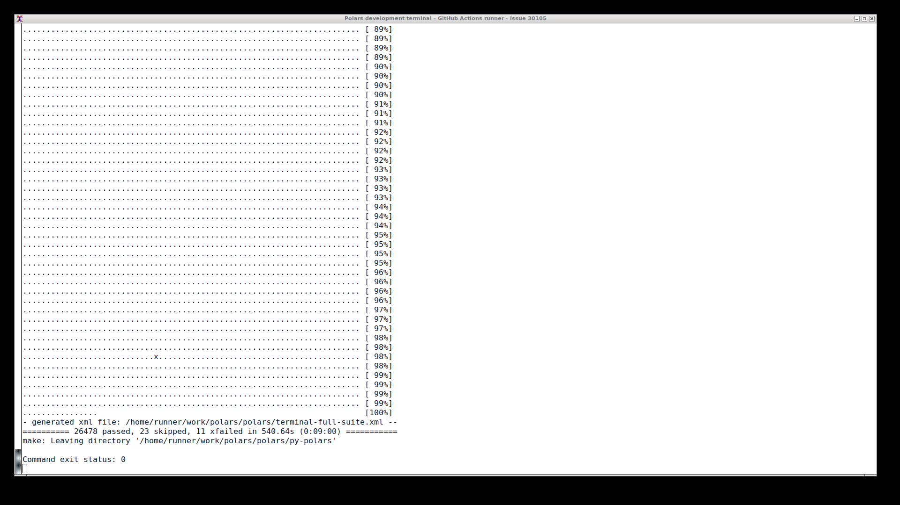
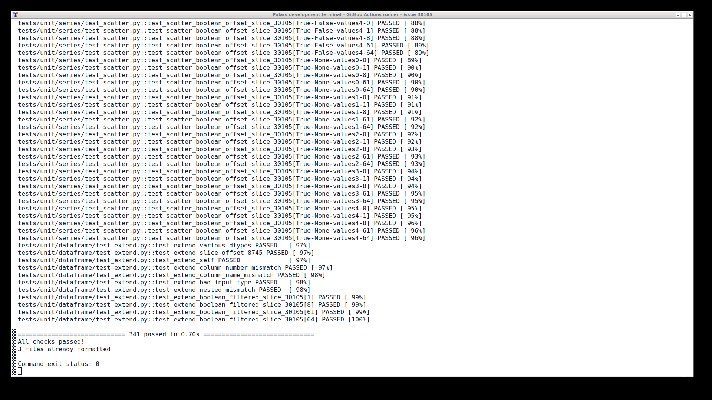
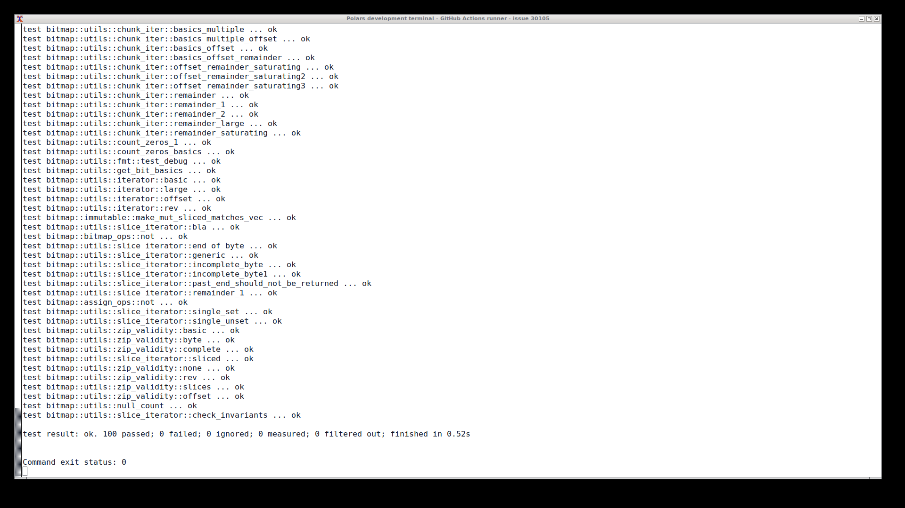

# Polars #30105 — implementation and validation evidence

This folder contains technical evidence for [issue #30105](https://github.com/pola-rs/polars/issues/30105). It is an evidence archive in the contributor's fork, not an upstream PR description or an automated submission instruction.

## Candidate

- Repository: `pola-rs/polars`.
- Issue: `extend` and `scatter` corrupt Boolean values and nulls of an offset slice.
- Issue status checked when this archive was prepared: open, accepted, P-high, no assignee.
- Upstream base: `04e0a7e625288e41dadf837992553b02d30380db`.
- Candidate branch: [fix/bitmap-offset-30105](https://github.com/Utkarsh-Sinha0/polars/tree/fix/bitmap-offset-30105).
- Candidate commit: [95260c56c1eb30b46a60da4628428206bc5db092](https://github.com/Utkarsh-Sinha0/polars/commit/95260c56c1eb30b46a60da4628428206bc5db092).
- [Review the complete candidate diff](https://github.com/Utkarsh-Sinha0/polars/compare/04e0a7e625288e41dadf837992553b02d30380db...95260c56c1eb30b46a60da4628428206bc5db092).
- [Download the patch](bitmap-offset-30105.patch).
- Scope: five files, 164 added lines; only three production lines. Evidence and validation infrastructure are kept off the candidate branch.

## Root cause and fix

A logical bitmap bit at index `i` is stored at `offset + i`. `MutableBitmap` has no offset field. Owning the storage uniquely therefore does not make a bitmap with a nonzero offset eligible for a zero-copy mutable conversion.

Previously, `Bitmap::into_mut` could transfer the original allocation without accounting for that offset. Later mutations could interpret the prefix as the logical values or validity mask. Byte-aligned slices are affected too: an offset of 8 or 64 does not move the allocation's base pointer.

The fix returns `Either::Left(self)` immediately when the offset is nonzero. Existing callers already handle this result, and `make_mut` already provides a bit-realignment path. No second realignment implementation or new dependency was introduced. The issue report already identified the missing offset guard.

The check is constant-time. Eligible zero-offset, uniquely owned buffers retain their storage-reuse path. Nonzero-offset slices take the existing safe fallback.

## Changed files

| File | Purpose |
| --- | --- |
| `crates/polars-arrow/src/bitmap/immutable.rs` | Reject nonzero-offset zero-copy mutable conversion. |
| `crates/polars/tests/it/arrow/bitmap/immutable.rs` | Four internal regression/property tests, including storage reuse. |
| `py-polars/tests/unit/series/test_extend.py` | Boolean slice extension regressions. |
| `py-polars/tests/unit/series/test_scatter.py` | Boolean slice scatter regressions. |
| `py-polars/tests/unit/dataframe/test_extend.py` | Filtered Boolean DataFrame extension regression. |

## Coverage

The new Python regression matrix has 314 cases. The three affected Python files contain 341 tests in total, including the existing tests.

Coverage includes empty, single-value, all-null, mixed-null and multiword slices; shared and uniquely owned storage; unaligned, byte-boundary and word-boundary offsets; zero-offset truncation; retained-parent integrity; and mutation after conversion.

The Rust property test compares conversion and append behavior with a plain Boolean vector, varying slice bounds, storage sharing and cached unset-bit counts. The recorded runs configured 1,024 examples. The zero-offset test checks pointer equality as well as correct append behavior, preserving the allocation-reuse guarantee.

## Recorded validation

| Run | Environment | Result |
| --- | --- | --- |
| [39505871847](https://github.com/Utkarsh-Sinha0/polars/actions/runs/39505871847) | Linux and Windows, pinned Rust | 100 bitmap tests passed on each platform. The unpatched baseline failed the three offset-sensitive regression tests as expected; the patched suite passed. |
| Same run | Linux, Python 3.13, runtime built from source and pinned Iceberg plugin | Standard `make test`: 26,478 passed, 23 skipped, 11 expected failures, no failures; 420.18 seconds of test execution. |
| Same run | Three affected Python test files | 341 passed. Ruff checks, Python formatting and pinned Rust formatting passed. |
| [39509583205](https://github.com/Utkarsh-Sinha0/polars/actions/runs/39509583205) | Fresh Linux graphical-terminal execution | Standard `make test`: 26,478 passed, 23 skipped, 11 expected failures; 540.64 seconds. |
| Same terminal run | Focused Python and Rust checks | 341 Python tests and 100 Rust bitmap tests passed; command exit statuses were 0. |

The standard `make test` target was used. This is not a claim that every optional benchmark, slow test, external service, release configuration, GPU target, or platform/version combination was exercised.

### Commands

The full terminal run executed:

```bash
make -C py-polars test 'PYTEST_ARGS=-n 2 --junitxml=../terminal-full-suite.xml'
```

The focused check executed:

```bash
cd py-polars
../.venv/bin/pytest -v tests/unit/series/test_extend.py tests/unit/series/test_scatter.py tests/unit/dataframe/test_extend.py
../.venv/bin/ruff check --no-fix tests/unit/series/test_extend.py tests/unit/series/test_scatter.py tests/unit/dataframe/test_extend.py
../.venv/bin/ruff format --check tests/unit/series/test_extend.py tests/unit/series/test_scatter.py tests/unit/dataframe/test_extend.py
```

The internal Rust harness and terminal capture implementation are preserved in the [validation checkout](https://github.com/Utkarsh-Sinha0/polars/tree/aa5c7f2d90ce383af1ff3e4a04949533b9c2381e). The harness compiles the repository's bitmap integration tests against the actual Arrow crate, verifies baseline assertion failures, restores the candidate source, and runs the patched suite.

## Screenshots

These are genuine, uncropped 1920×1080 X11 desktop captures from a GitHub Actions runner. They show a real terminal executing the commands. The PNG bytes were not edited. The runner identity and window borders are preserved.

They are CI evidence, not a non-CI local-run screenshot. Naming a remote runner differently does not change that distinction.

1. [Environment and exact checkout](screenshots/polars-30105-01-environment.png).
2. [Source build in progress](screenshots/polars-30105-02-build-running.png).
3. [Standard suite completed](screenshots/polars-30105-03-full-suite.png).
4. [Focused Python tests and lint completed](screenshots/polars-30105-04-focused.png).
5. [Rust bitmap tests completed](screenshots/polars-30105-05-rust-bitmap.png).

[Download all screenshots and their provenance manifest](polars-30105-terminal-screenshots.zip).







## Logs and integrity

- [Standard Python job log](logs/python-standard-39505871847.log).
- [Linux Rust job log](logs/rust-linux-39505871847.log).
- [Windows Rust job log](logs/rust-windows-39505871847.log).
- [Screenshot provenance and SHA-256 checksums](provenance.json).
- The terminal run's complete phase logs and XML report are also attached to the [workflow run](https://github.com/Utkarsh-Sinha0/polars/actions/runs/39509583205) as `polars-terminal-evidence`.

The logs retain their original timestamps and belong to the runs named above. The earlier full-suite log and fresh terminal screenshot have different durations because they are separate executions of the same candidate.

## Upstream submission requirements

This contribution is AI-assisted, including implementation, regression tests, validation automation and evidence organization. Human review does not remove the required disclosure. Before an upstream submission, the contributor must identify every AI tool used and the extent of its assistance in their own words.

The contributor reported completing an end-to-end human code review. The attached execution evidence is automated CI execution; it must not be described as independent manual execution.

Read the current [AI policy](https://github.com/pola-rs/polars/blob/main/AI_POLICY.md), [PR template](https://github.com/pola-rs/polars/blob/main/.github/pull_request_template.md), and [contribution guide](https://github.com/pola-rs/polars/blob/main/docs/source/development/contributing/index.md) before submission.

- Upstream interactions, including opening the PR, must be performed by a human. Another agent must not post it.
- The human must write the upstream PR description themselves; this archive is not a paste-ready PR body.
- AI use requires tool-and-extent disclosure. Do not claim no assistance.
- The issue must remain accepted and must not be a good-first-issue task.
- Human verification and the project's first-time-contributor local-test screenshot requirements still apply. The CI screenshots here do not satisfy its non-CI screenshot requirement.
- No upstream PR, comment, issue, review, or reaction has been posted as part of this work.
